# Fastwell

-brightgreen)

Track your fasts, meals and workouts in one place. Fastwell combines an intermittent fasting timer with a food journal, a workout journal and progress charts. All your data stays on your phone.

  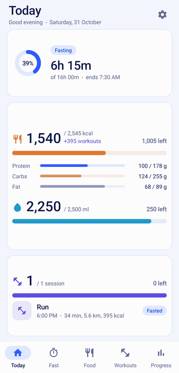

## Features

### Fasting
- Choose a 13:11, 16:8, 18:6, 20:4 or 23:1 plan, or set a custom length
- Follow a live timer through six fasting stages, from digesting your last meal to an extended fast
- See the timer in the notification bar and get a reminder when you reach your goal
- Adjust your start time, and rate how each fast felt when you end it
- Browse past fasts in a history calendar

| Fast timer | Fasting stages | Fasting history |
| :---: | :---: | :---: |
| 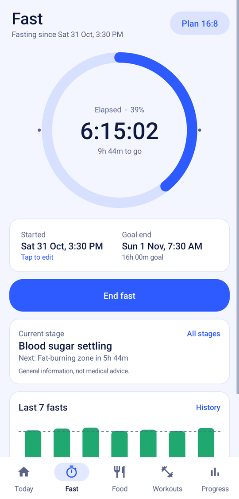 | 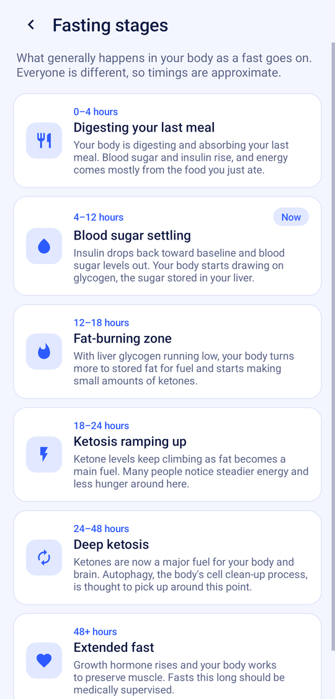 | 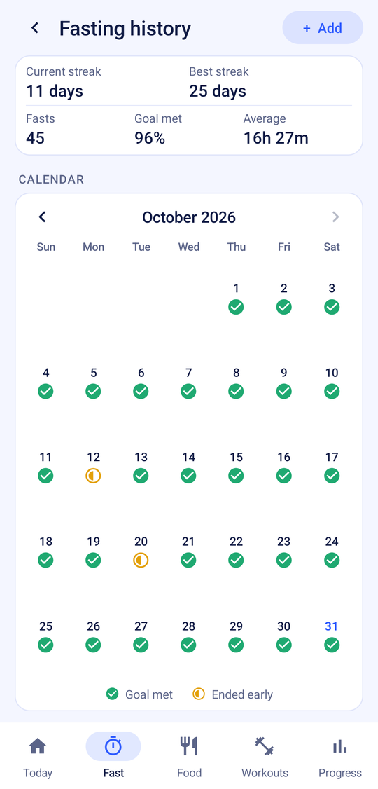 |

### Food and water
- Log meals by searching Open Food Facts and your saved foods, or type in your own numbers
- Get a daily calorie and macro target based on your profile, with a deficit or surplus if you want one
- Have your calorie and macro targets rise with the workouts you log
- Track water against a daily target
- Log zero-calorie drinks like black coffee without ending your fast

| Food journal | Log food | Log water |
| :---: | :---: | :---: |
| 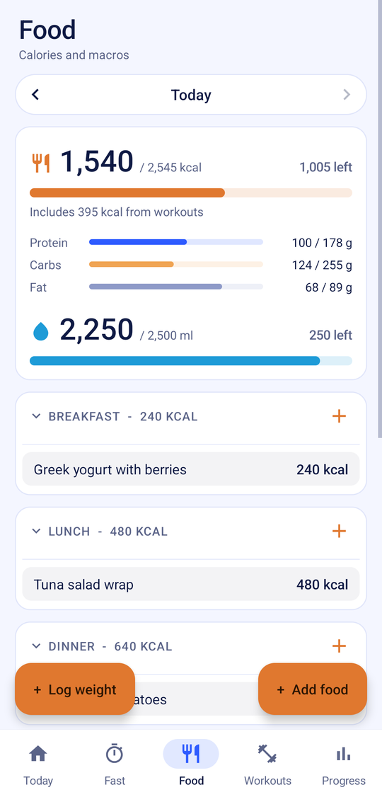 | 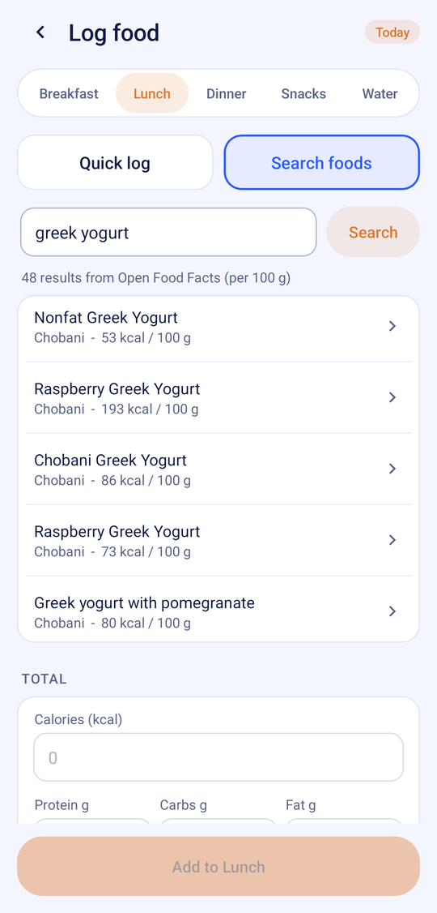 | 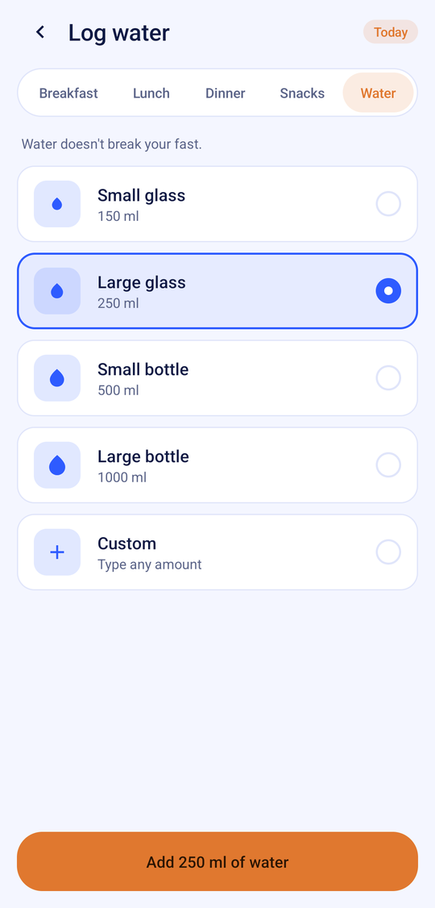 |

### Workouts
- Log cardio and strength sessions with duration, effort and an optional note
- Pick from running, walking, cycling, swimming, rowing, elliptical and hiking, or name your own activity
- Get a calorie estimate from your duration, effort and weight
- Mark each session as fasted or fed
- Set a daily workout target and choose your rest days

| Workouts | Log cardio | Log strength |
| :---: | :---: | :---: |
| 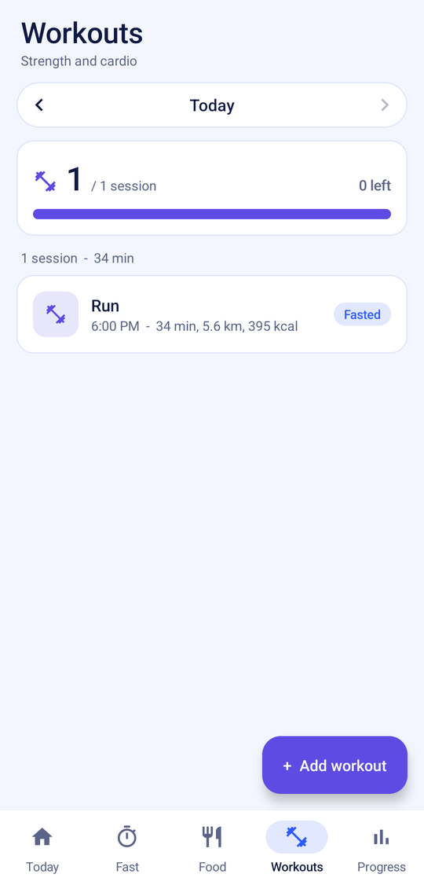 | 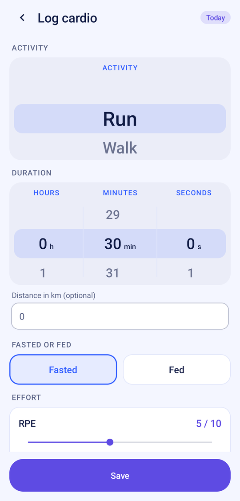 | 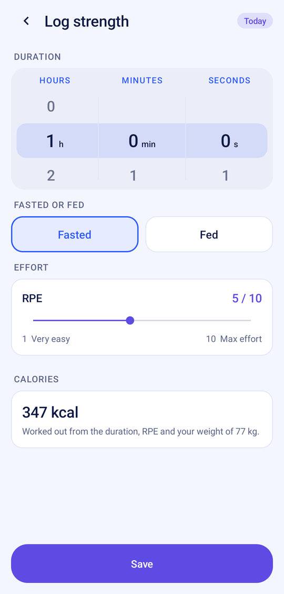 |

### Progress
- See your day at a glance on the Today screen
- Follow fasting hours, calories, training sessions and weight over the last week or month
- Keep track of your current and best fasting streaks

| Today | Progress | Weight and calories |
| :---: | :---: | :---: |
| 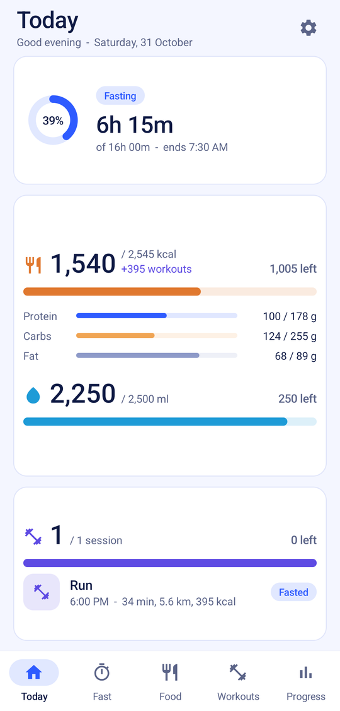 | 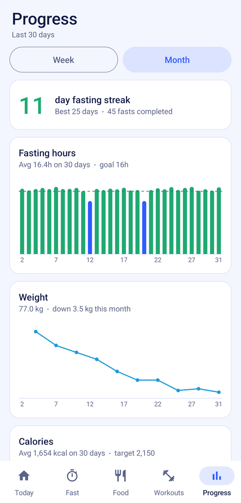 | 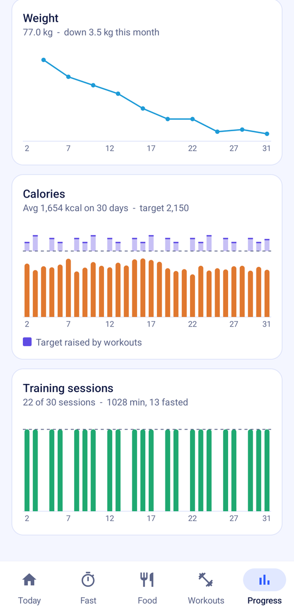 |

### Home-screen widget
- Check your fast from the home screen with a timer widget
- Use it at 2x2, or resize it to a side by side 4x2

| 2x2 | 4x2 |
| :---: | :---: |
| 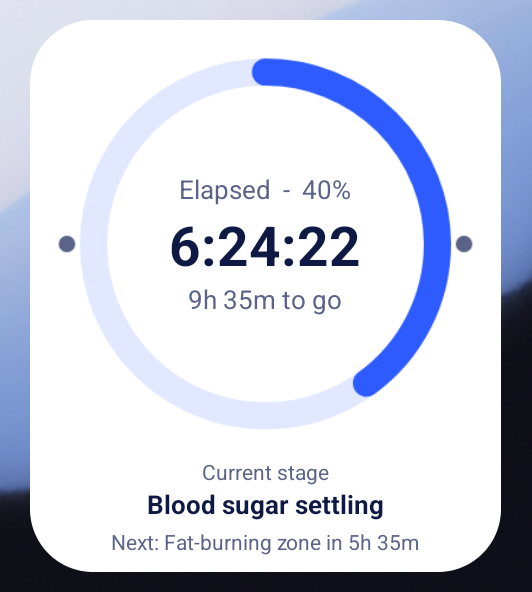 | 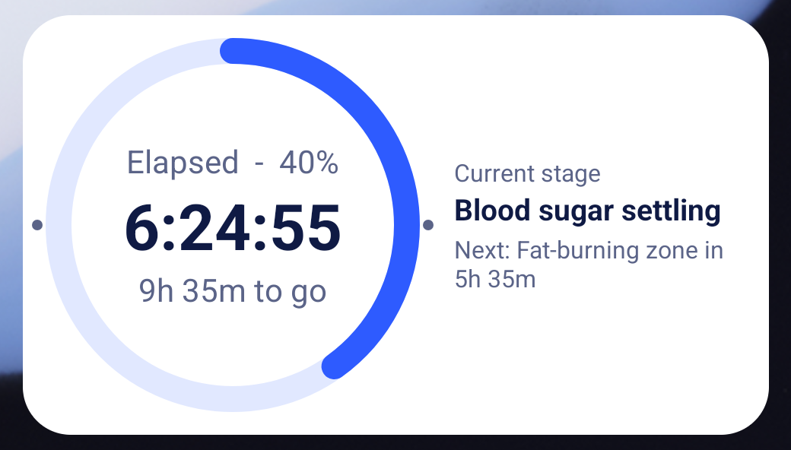 |

### Your data
- Export everything to a JSON file and restore it from a backup
- Delete all your data at any time
- Use light or dark theme, matching your system setting

Food search is the only feature that sends anything off your phone: your search terms go to Open Food Facts.

Fastwell gives general information, not medical advice.

## Install
Copy `Fastwell-1.0.0.apk` to the phone, open it, and allow "Install unknown apps" for the app you opened it from.

## Build
Works on Debian 12/13, Ubuntu 22.04+ and WSL. Install a JDK and three Android tools:

    sudo apt install default-jdk-headless aapt zipalign apksigner

Then:

    ./build.sh          # -> out/Fastwell-1.0.0.apk
    tests/run.sh        # JVM tests for the fasting/calorie/streak logic

`dx` and the API 23 framework resources are bundled in `tools/` (see `tools/README.md`), so no distro Android SDK packages are needed. On the first run `build.sh` downloads the API 36 `android.jar` (~53 MB, from https://github.com/Reginer/aosp-android-jar) to `sdk/android-36.jar`.

The signing key `keystore/fastwell.jks` is deliberately not in the repo. Put your copy there before building: Android only installs an update over the app if it is signed with the same key. Without it, `build.sh` creates a new key, and that build won't install over existing copies.
